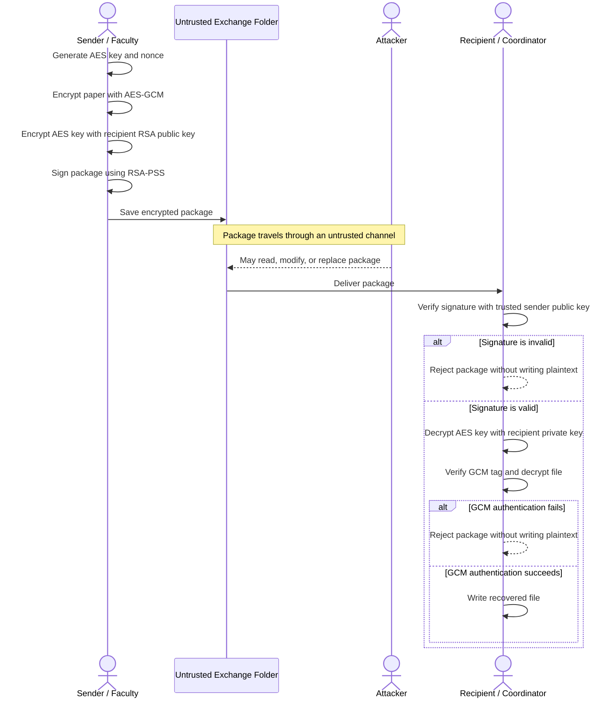

# Sequence Diagram - Secure Examination-Paper Exchange

## Walkthrough

1. The sender encrypts the paper with a fresh AES key and nonce.
2. The sender encrypts that AES key with the recipient's RSA public key.
3. The sender signs the package, including its metadata, encrypted key, nonce, ciphertext, and authentication tag.
4. The package passes through the untrusted exchange folder. An attacker may change it, but cannot make a modified package pass signature verification without the sender's private key.
5. The recipient verifies the signature, recovers the AES key, and checks the GCM authentication tag.
6. The program writes the recovered file only after the checks succeed.
